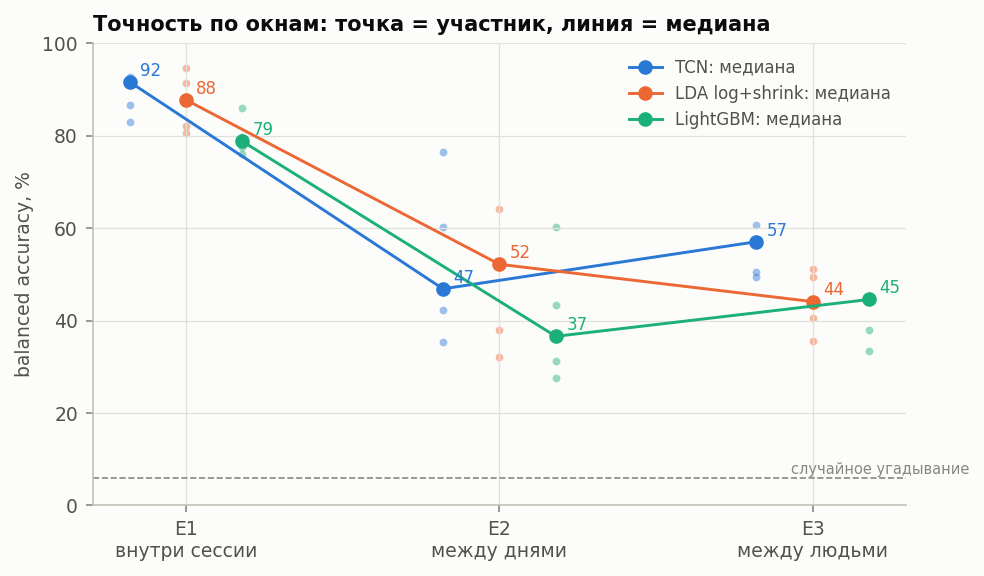
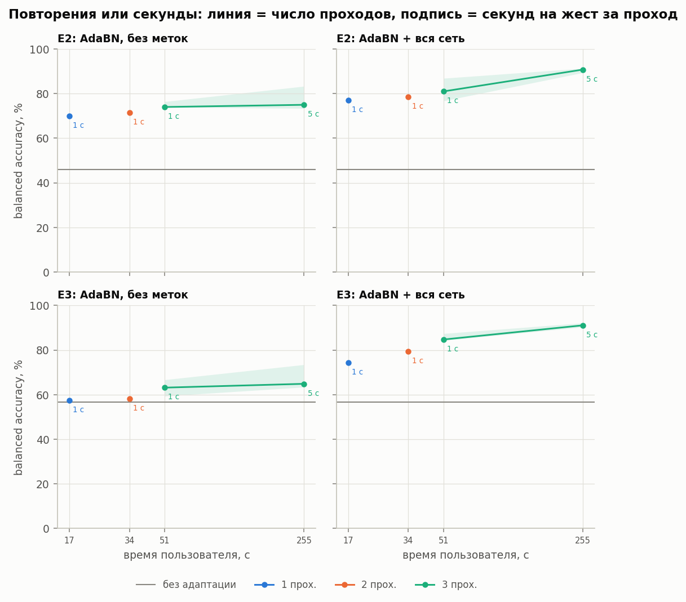
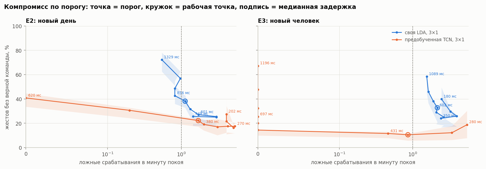
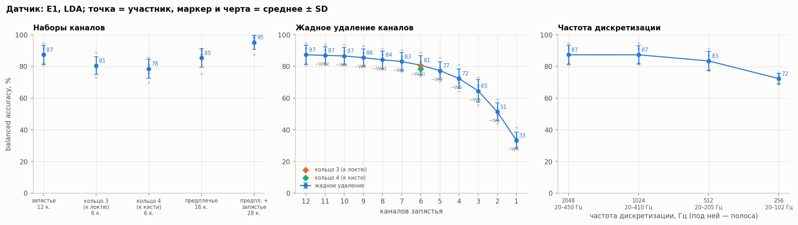
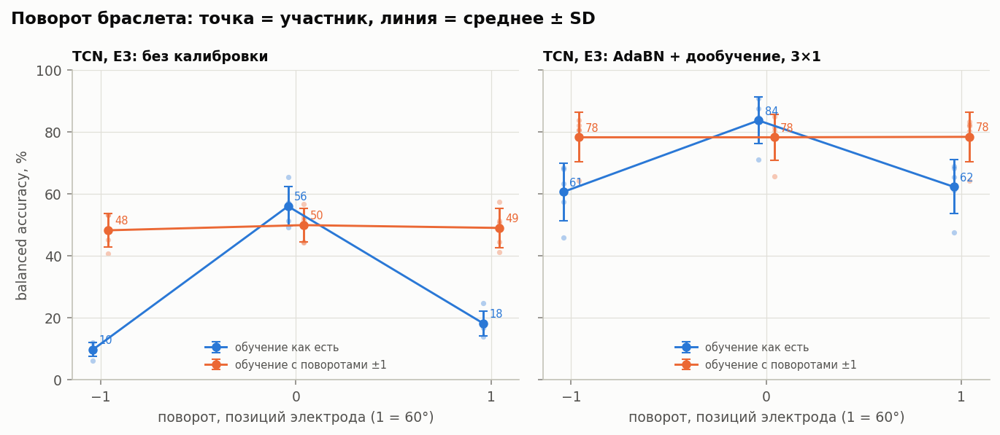
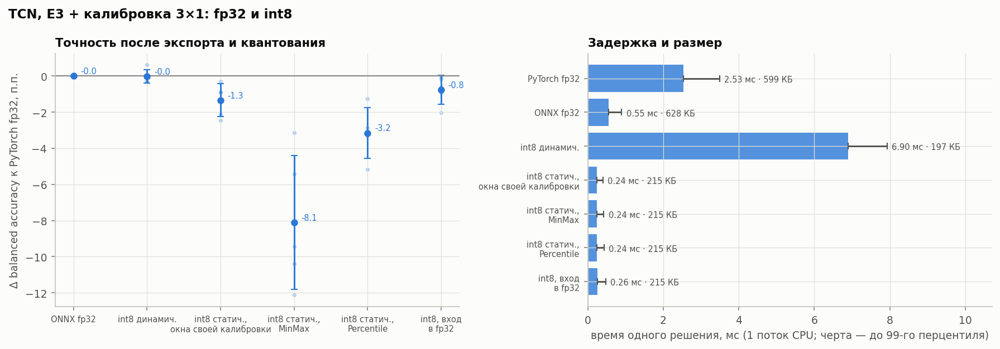

# Жесты по ЭМГ запястья: перенос, поток и требования к датчику

Исследование того, что происходит с распознаванием жестов по поверхностной ЭМГ браслета на запястье за пределами
одной записи: когда браслет надевают заново в другой день, когда пользователь новый, когда решения нужны
в непрерывном потоке, когда у датчика меньше каналов, ниже частота, он повёрнут или у него отказал электрод,
и когда модель должна поместиться на устройство.

Данные — [GRABMyo](https://physionet.org/content/grabmyo/1.1.0/) (PhysioNet): 12 каналов запястья, 2048 Гц,
16 жестов + покой, 3 сессии в разные дни. Модели — LDA и LightGBM на признаках временной области и причинная
свёрточная сеть (TCN) на сыром сигнале. Все итоговые цифры — на 5 отложенных участниках, на которых ничего не подбиралось.

**Полный отчёт: [`reports/report.md`](reports/report.md).**

## Главное

1. **Новое надевание стоит 35–40 п.п.** Внутри одной записи ~89 %, та же модель в другой день — 52 %, модель на 10 других людях для нового человека — 55 %. Сеть переносится лучше LDA тем сильнее, чем больше сдвиг (у 14 из 15 человек между людьми).
2. **51 секунда калибровки при надевании** (три прохода по всем жестам по 1 с) и дообучение предобученной сети дают 82–84 % у всех участников, 255 с — 90–91 %. Выигрыш сети здесь целиком от предобучения: та же архитектура с нуля не лучше LDA.
3. **В потоке** предобученная сеть для нового человека даёт 89,5 % верных команд при 0,9 ложного срабатывания в минуту покоя и медианной задержке 378 мс; LDA — 62–67 % и 600–800 мс.
4. **Датчик:** частоты 1 кГц достаточно (512 Гц −4 п.п., 256 Гц −15); 9 из 12 каналов стоят 1,8 п.п.; поворот браслета на одну позицию электрода без защиты сводит распознавание к угадыванию, обучение с поворотами держит 78 % при любом сдвиге; отказ канала без детектора стоит 25–78 п.п., с детектором и запасной моделью — ≤ 2.
5. **На устройстве** сеть в int8 занимает 215 КБ и решает за 0,26 мс (CPU, 1 поток) при потере 0,8 п.п. — если вход оставить во float: восьми бит на входе мало для динамического диапазона ЭМГ. Задержку команды на 75 % задаёт постобработка, инференс — 0,07 %.

## Ключевые графики

| | |
|---|---|
|  | **Перенос между днями и людьми** (test): одно надевание → новый день → новый человек для TCN, LDA и LightGBM. |
|  | **Калибровка при надевании:** точность против времени пользователя; повторения важнее секунд. |
|  | **Поток:** пропуски против ложных срабатываний в минуту покоя, рабочие точки и задержка. |
|  | **Каналы и частота:** наборы каналов, жадное удаление, 2048 → 256 Гц. |
|  | **Поворот браслета** на ±1 позицию электрода: без защиты и с обучением на поворотах. |
|  | **Модель на устройстве:** точность, время и размер для fp32 и вариантов int8. |

## Как устроена оценка

- Участники зафиксированы заранее (`configs/splits.yaml`): **dev** — 10 человек для всех решений, **test** — 5 человек, один прогон с замороженными настройками.
- Сценарии: **E1** — одно надевание (попытки 1–5 → 6–7), **E2** — новый день (сессия 1 → 2, 3), **E3** — новый человек.
- Разбиения только по попыткам, сессиям и людям, никогда по окнам; только причинная фильтрация (`sosfilt` с состоянием); статистики нормализации — только по обучающим данным, если это не явно названный метод адаптации.
- Окно решения 200 мс, шаг 50 мс; метрика — balanced accuracy по участникам с разбросом, сравнения — попарно по участникам; в потоке — доля верных команд, ложные в минуту покоя, лишние на жест, задержка.

## Структура

```
run.py              точка входа: python run.py --config configs/<имя>.yaml
configs/            один YAML на эксперимент (+ splits.yaml с участниками)
src/
  data.py           загрузка GRABMyo, индекс попыток, раскладка каналов
  preprocess.py     причинные фильтры, окна
  features.py       признаки Хаджинса, понижение частоты
  quality.py        качество сигнала по каналам и сессиям
  splits.py         сценарии E1–E4
  models.py         LDA / LightGBM
  signals.py        отфильтрованный сигнал для сети
  tcn.py            причинная TCN, обучение
  adapt.py          адаптация без меток и калибровка
  streaming.py      поток, постобработка, метрики событий
  robustness.py     каналы, частота, поворот, отказы
  export.py         ONNX, int8, задержка, бюджет
  evaluate.py, viz.py
notebooks/          01–08: разбор каждого этапа с графиками (ничего не обучают)
results/            <эксперимент>.json и таблицы оценок
reports/            report.md, notes.md (журнал экспериментов), figures/
```

## Запуск

**Окружение:** Python 3.11, `pip install -r requirements.txt` (PyTorch с CUDA желателен для обучения сети).

**Данные** (~0,22 ГБ на участника, файлы сверяются с SHA256, источник — зеркало PhysioNet на AWS):
```
python src/data.py --subset dev
python src/data.py --subset test
```

**Эксперименты** — по этапам; у каждого dev-конфига есть test-двойник с замороженными настройками. Базовые сети и признаки кэшируются в `data/cache/`, поэтому повторные запуски дешёвые.

| этап | dev | test |
|---|---|---|
| качество сигнала | `quality_dev` | — |
| признаки + LDA / LightGBM | `baseline_dev_e1`, `_e2`, `_e3` | `baseline_test_e1`, `_e2`, `_e3` |
| TCN | `tcn_dev_e1`, `_e2`, `_e3` | `tcn_test_e1`, `_e2`, `_e3` |
| адаптация и калибровка | `adapt_lda_dev`, `adapt_lda_passes_dev`, `adapt_tcn_dev`, `adapt_tcn_scratch_dev` | `adapt_lda_test`, `adapt_tcn_test`, `adapt_tcn_scratch_test` |
| поток | `stream_dev` | `stream_test` |
| устойчивость и каналы | `robust_lda_dev`, `robust_tcn_dev` | `robust_lda_test`, `robust_tcn_test` |
| модель на устройстве | `export_dev` | `export_test` (после `stream_dev` и `stream_test`) |

Ранняя разведка на 5 участниках: `baseline_dev`, `lda_variants_dev`, `tcn_dev_e1_drop0.2`.

```
python run.py --config configs/stream_dev.yaml
```

Сиды фиксированы; на GPU дообучение сети воспроизводится с точностью до ~3·10⁻⁴ BA.

## Ограничения

15 участников из 43, один сид; поток собран из попыток (в GRABMyo жест удерживается всю попытку, переходов нет — задержка является нижней оценкой, ложные срабатывания оценены по 20 с уникального покоя на сессию); повороты только целым шагом электрода; время инференса — на CPU ноутбука. Подробно — в разделе 9 отчёта.

## Данные

Pradhan A., He J., Jiang N. *Multi-day dataset of forearm and wrist electromyogram for hand gesture recognition and biometrics.* Scientific Data, 2022. PhysioNet: GRABMyo 1.1.0.
